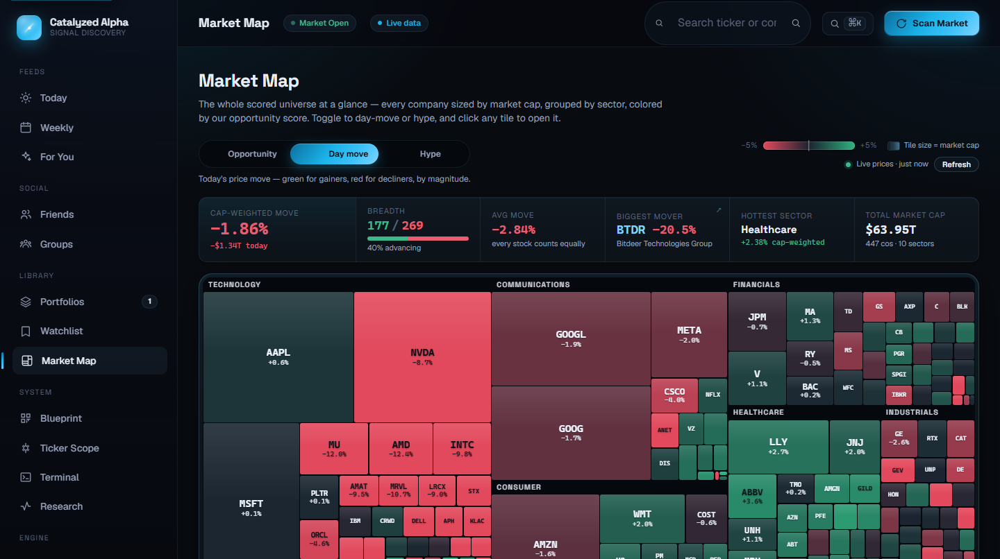
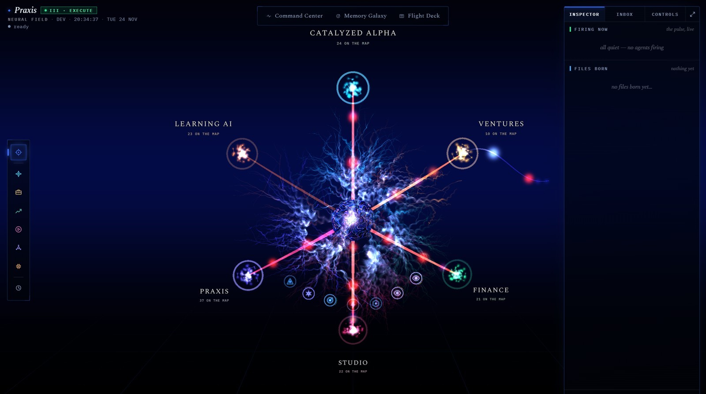
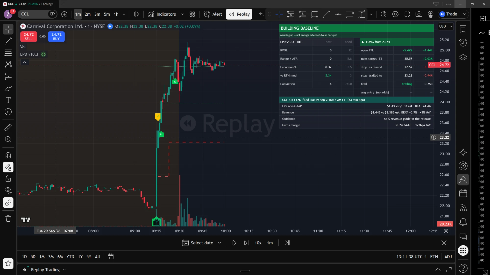
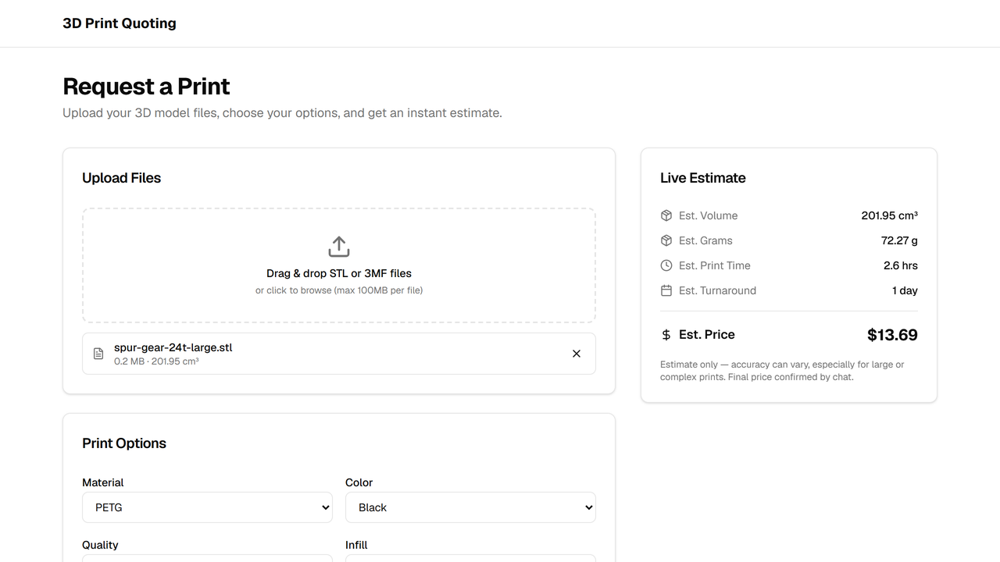

# Zachary Adams

Mathematics and Engineering at Queen's University, Systems and Robotics sub-stream. First year complete with a 4.20 cumulative GPA (4.3 scale), entering second year. Expected graduation April 2030.

Writes C. Builds in TypeScript, Rust and Python by directing AI coding agents, with deterministic code and tests checking what they produce.

[LinkedIn](https://www.linkedin.com/in/zachary-adams-239894386/)

## Main projects

<table>
<tr>
<td width="50%" valign="top">

<h3><a href="https://github.com/zachadams007/catalyzed-alpha-platform">Catalyzed Alpha</a></h3>

Equity research platform with built-in AI. Language models write a daily pick with cited sources, turn a plain-language description into real tickers, scan the news for catalysts and write bull and bear cases from live fundamentals and insider trades. Underneath, a daily pipeline narrows about 21,000 US listings to 500 and a deterministic engine scores them on 13 dimensions. The models collect evidence; the engine computes every score.

127,648 lines of TypeScript, 1,877 tests, 26 Postgres tables. <a href="https://catalyzed-alpha.vercel.app">Live site</a>

</td>
<td width="50%" valign="top">

<h3><a href="https://github.com/zachadams007/praxis-desktop">Praxis</a></h3>

Windows desktop environment that orchestrates coding agents. Reads live Claude Code, Codex and Cursor sessions, runs headless agents in parallel lanes, verifies each lane on exit, and is driven by voice.

48,429 lines of Rust, 67,645 of TypeScript, 418 Rust unit tests. Tauri, React, Three.js

</td>
</tr>
<tr>
<td width="50%" valign="top">

<h3><a href="https://github.com/zachadams007/earnings-print-indicator">Earnings Print Detector</a></h3>

TradingView indicator in Pine Script v6 that finds the one-minute candle where a stock starts reacting to its earnings release, confirms it on a separate candle and manages the trade. A Python watcher polls SEC EDGAR for the earnings filing and puts EPS and revenue against consensus on the chart.

3,861 lines of Pine Script, 3,908 of filing tools, 210 research tests. Backtest reports: <a href="https://claude.ai/artifact/FLG2NNmhR26iBwXKiEEmRa">August, 34 trades</a> and <a href="https://claude.ai/artifact/1pazq181gKbX4ECz177kHE">September, out of sample, 22 trades</a>

</td>
<td width="50%" valign="top">

<h3><a href="https://github.com/zachadams007/3d-print-quoting">3D Print Quoting Site</a></h3>

Storefront for a 3D printing service. The browser prices an STL or 3MF from its true solid volume, with a shell-and-infill model tuned against real prints. A file with no measurable volume goes to manual review instead of getting a wrong price.

22 API route files, 10 tables, 14 estimator tests. Next.js, Supabase. <a href="https://3d-print-site-ten.vercel.app/">Live site</a>

</td>
</tr>
</table>

| Project | Summary |
|---|---|
| [AI Development Workflow](https://github.com/zachadams007/ai-development-workflow) | Operating setup for coding agents: rules injected on every turn, memory that new sessions rebuild from, ten skills, and a snapshot that refuses to commit a credential |

## Code worth opening

| Problem | File |
|---|---|
| A backtest that must never see the future: a test plants a future-dated bar and checks it never reaches the replay | [`noLeak.test.ts`](https://github.com/zachadams007/catalyzed-alpha-platform/blob/main/scripts/backtest/__tests__/noLeak.test.ts#L99) |
| Cross-sectional ranking of the day's universe in one module | [`normalizeUniverse.ts`](https://github.com/zachadams007/catalyzed-alpha-platform/blob/main/src/engine/normalizeUniverse.ts) |
| A watchdog that tells a silent webview from a crashed one | [`lib.rs`](https://github.com/zachadams007/praxis-desktop/blob/main/src-tauri/src/lib.rs#L1031) |
| A process registry that survives PID reuse | [`flightdeck.rs`](https://github.com/zachadams007/praxis-desktop/blob/main/src-tauri/src/flightdeck.rs#L5591) |
| A shuffled-bars control test that passed because it had tested nothing | [`controls.py`](https://github.com/zachadams007/earnings-print-indicator/blob/main/scalping/src/bot/scalp/controls.py) |
| Six credential patterns checked before anything is staged | [`snapshot.py`](https://github.com/zachadams007/ai-development-workflow/blob/main/versioning/snapshot.py) |

## Data engineering

- **Catalyzed Alpha.** The [data model](https://github.com/zachadams007/catalyzed-alpha-platform/blob/main/docs/data-model.md) covers 26 Postgres tables with row-level security and 28 migrations. The [daily scan](https://github.com/zachadams007/catalyzed-alpha-platform/tree/main/scripts/universe_scan) and the [point-in-time replay harness](https://github.com/zachadams007/catalyzed-alpha-platform/tree/main/scripts/backtest) are the pipeline.
- **Earnings Print Detector.** [`earnings_watch.py`](https://github.com/zachadams007/earnings-print-indicator/blob/main/tools/earnings_watch.py) polls SEC EDGAR for each earnings 8-K, parses the press release and joins it to consensus for the reported and guided quarters. Each result carries the moment the SEC accepted the filing, so in bar replay it appears on the bar the filing landed in. [`score_extraction.py`](https://github.com/zachadams007/earnings-print-indicator/blob/main/tools/score_extraction.py) scores the parser field by field against 106 hand-read answer-key entries, and [`build_corpus.py`](https://github.com/zachadams007/earnings-print-indicator/blob/main/tools/build_corpus.py) fetches each filing as of the key's date so a later quarter is never scored by mistake.
- **Scalping research package.** [`store.py`](https://github.com/zachadams007/earnings-print-indicator/blob/main/scalping/src/bot/data/store.py) keeps bars, news and trade records in SQLite behind 13 versioned migrations. The parameter sweep appends every distinct configuration to an append-only [trial ledger](https://github.com/zachadams007/earnings-print-indicator/blob/main/scalping/src/bot/backtest/trial_ledger.py) before ranking, so a multiple-testing penalty counts every trial that was run.

## Working method

Agents write most of the code, under written rules. In Catalyzed Alpha the ranking engine owns the score; in Praxis a lane's verify command outranks its exit code. A failure that gets through becomes a written rule, often with a test. [AI Development Workflow](https://github.com/zachadams007/ai-development-workflow) holds the rules.

## Robotics and hardware

- MARC, the Moon Autonomous Rover for Cargo, a Canadian Space Agency client project. Team lead, with work on servo control and camera-guided autonomous pickup.
- A scratch-built RC airplane with CAD.
